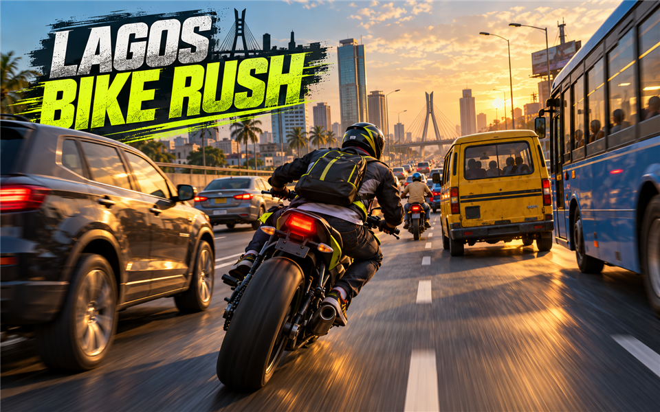

# Lagos Bike Rush



An endless 3D motorcycle traffic-dodging game inspired by the pace and character of Lagos roads. Ride between cars, motorcycles, buses and yellow danfos, survive for as long as possible and climb the shared [start.ng](https://start.ng) leaderboard.

The game is built with Three.js, TypeScript and Vite. It runs entirely in the browser and supports desktop keyboards and mobile touch controls.

## Gameplay

The objective is simple: keep moving and avoid every vehicle.

1. Choose a rider.
2. Steer through three lanes of moving traffic.
3. Pass vehicles cleanly to increase the dodge count.
4. Watch the road become faster and more crowded as the score rises.
5. Avoid collisions—a single hit ends the run.
6. Restart immediately and try to beat your best score.

A dodge is counted only after a traffic vehicle passes behind the rider without making contact. The motorcycle begins at a manageable speed, then accelerates after successful dodges. Traffic also spawns more frequently as the run progresses.

## Features

- Endless procedurally recycled road and city scenery
- Cars, motorcycles, buses and Lagos-style yellow danfos
- Increasing speed and traffic density
- One-hit collision and instant restart loop
- Three rider forms: start.ng character, monkey and robot
- Rider colours derived from the player's start.ng character
- Signed-in and guest player support
- Shared start.ng leaderboard
- Local personal-best fallback
- Keyboard and mobile touch controls
- Pause and sound controls
- Responsive interface for desktop and mobile screens
- Procedural engine and game-feedback audio
- Lightweight procedural 3D models with no downloaded model dependency

## Controls

| Action | Keyboard | Mobile |
| --- | --- | --- |
| Steer left | `A` or `←` | Left arrow button |
| Steer right | `D` or `→` | Right arrow button |
| Pause or resume | `P` or `Esc` | Pause button |
| Mute or enable sound | Sound button | Sound button |

The game automatically pauses when its browser tab becomes hidden during an active run.

## Rider and start.ng character support

The game connects to start.ng through a hidden `https://start.ng/connect` frame using the documented `postMessage` protocol. Replies are accepted only when both the message origin and frame source are valid.

For every player, the integration can provide:

- Character name
- Account name
- Profile face image
- Body type
- Primary and secondary clothing colours
- Skin and hair colours
- Hair, hat and accessory choices

The **Start.ng** rider represents the player's official character. The **Monkey** and **Robot** forms are optional game-specific riders that retain the player's selected colours. The player's start.ng identity card remains visible in the interface.

When the game is opened outside a `*.start.ng` address, the connect frame may not answer. The game then uses a guest rider so local development and offline gameplay remain functional.

## Leaderboard

The shared leaderboard is declared in [`startng.json`](startng.json) and ranks runs using these fields:

| Stat | Ranking | Format |
| --- | --- | --- |
| `dodges` | Highest first | Number |
| `distance` | Highest first | Metres |
| `time` | Highest first | Time |

The first stat determines the main rank. Distance and ride time break ties. Signed-in players can save scores; guests can view the leaderboard and are invited to sign in before submitting a run.

## Technology

- [Three.js](https://threejs.org/) for 3D rendering
- TypeScript in strict mode
- Vite for development and production builds
- Plain HTML and CSS for menus, the HUD and touch controls
- Web Audio API for procedural sound
- Browser `localStorage` for the guest personal best
- start.ng connect API for player identity, scores and leaderboards

No application server, database, API secret or authentication credential is stored in this repository.

## Project structure

```text
lagos-bike-rush/
├── dist/                 Committed production build served by start.ng
├── public/
│   ├── cover.png         16:10 game-card artwork
│   ├── favicon.svg       Browser icon
│   └── startng.json      Manifest copied into the production build
├── src/
│   ├── main.ts           Three.js scene, vehicles, gameplay and interface logic
│   ├── startng.ts        start.ng identity, score and leaderboard adapter
│   └── style.css         Responsive game interface
├── AGENTS.md             Repository guidance for coding agents
├── index.html            Accessible interface shell and canvas
├── startng.json          Leaderboard definition for repository checks
├── package.json          Scripts and dependencies
├── tsconfig.json         Strict TypeScript configuration
└── vite.config.ts        Relative-path production build configuration
```

## Local development

### Requirements

- Node.js 20 or newer
- Corepack, included with supported Node.js releases
- A modern browser with WebGL support

### Install and run

```powershell
git clone https://github.com/OBA-UI-CODE/lagos-bike-rush.git
cd lagos-bike-rush
corepack pnpm install
corepack pnpm dev
```

Open the local address printed by Vite, normally `http://localhost:5173`.

### Type-check and build

```powershell
corepack pnpm check
corepack pnpm build
```

The build command runs strict TypeScript checking before creating the production output in `dist/`.

## Why `dist/` is committed

Start.ng hosts static browser games directly from public GitHub repositories. It does not run `npm install` or `npm run build`. A ready-to-play `index.html` and every required asset must therefore already exist in a supported output folder.

Vite is configured with `base: "./"`, which produces relative asset paths that work correctly when start.ng serves the `dist/` directory. Whenever source files change, rebuild and commit the updated `dist/` files with them.

## Start.ng validation and publishing

The public repository should be checked before publishing:

```http
POST https://api.start.ng/games/check
Content-Type: application/json

{
  "repo_url": "https://github.com/OBA-UI-CODE/lagos-bike-rush",
  "name": "lagos-bike-rush",
  "branch": "main"
}
```

Publishing uses the same body with `POST https://api.start.ng/games/publish`. The first successful publish returns an approval link. After the owner signs in and approves the game, it is available at:

**https://lagos-bike-rush.start.ng**

Start.ng then watches the linked `main` branch and normally updates the hosted game after future pushes. A failed update leaves the last valid version online.

## Release checklist

Before pushing a gameplay update:

1. Test rider selection and guest fallback.
2. Verify keyboard and touch steering.
3. Confirm vehicles can be dodged and counted.
4. Confirm a collision ends the run.
5. Confirm restart and pause/resume work.
6. Run `corepack pnpm check`.
7. Run `corepack pnpm build`.
8. Review and commit both source and `dist/` changes.
9. Push `main` to GitHub.
10. Run the start.ng repository check when publishing requirements change.

## Performance notes

The game caps renderer pixel density, reuses traffic objects, recycles road segments and scenery, clamps large frame-time jumps and uses procedural geometry. These choices keep the initial download small and target smooth play on typical laptops and mid-range mobile devices.

## Current scope

This release focuses on a polished arcade loop. The environment and vehicles use original procedural low-poly geometry rather than large photorealistic models. There is currently one endless road environment, three rider forms and one leaderboard mode.

## Repository

- GitHub: [OBA-UI-CODE/lagos-bike-rush](https://github.com/OBA-UI-CODE/lagos-bike-rush)
- Intended start.ng address: [lagos-bike-rush.start.ng](https://lagos-bike-rush.start.ng)
